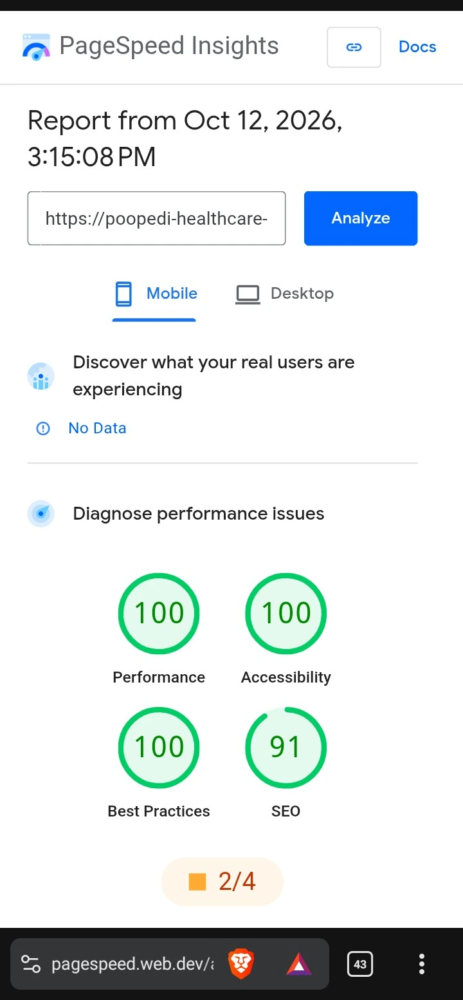
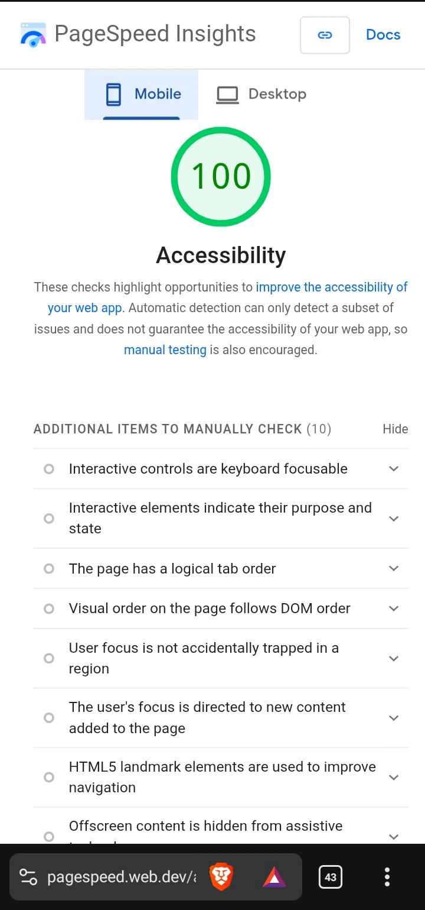
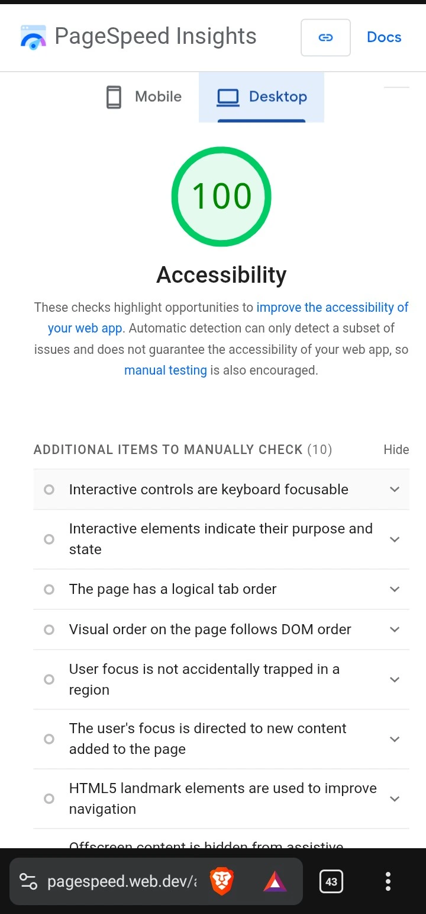

# Poopedi Healthcare Clinic: Accessible Booking Portal

Capstone 4 (ticket MD-2026-0143), Community Healthcare Clinic domain.

**Live site:** https://poopedi-healthcare-clinic.vercel.app

- Part A (wireframes, persona, WCAG matrix): `/wireframes`
- Part B (React SPA, tests, deployment config): repository root
- Part C (write-up): this file

```
npm install
npm run dev     # local development server
npm test        # 53 component and axe tests
npm run build   # production build (Vercel: vercel.json, Netlify: public/_redirects)
```

## Screenshots





## 1. Accessibility trade-off analysis

**Apply-on-submit filtering instead of live filtering.** Live filtering feels faster, but every checkbox click would rewrite the results and trigger a screen reader announcement, which is noisy and disorienting. Filters are drafted locally and applied with an "Apply filters" button. This costs one extra action, and in return the results change only when the user decides, with one clear announcement ("Showing 3 results with 1 filter applied").

**Native `<dialog>` instead of a custom modal.** A hand-built modal needs a focus trap, `aria-modal`, inert background handling and an Escape handler, and each of these can go wrong. `showModal()` gives an inert background and Escape for free. The cost is less control over styling and animation. A strict focus trap is also not required here, because Tab is allowed to reach the browser UI, so I return focus to the opener on close and kept the rest native.

**Announce errors on blur, not on every keystroke or every field.** Announcing every validation result would make the form unusable by ear. New errors are announced when a field is left, and a fixed field announces "is now valid" once. On a failed submit I move focus to the error summary rather than adding an assertive announcement, so the message is not read twice. The trade-off is that users hear nothing while typing, which is the quieter choice.

## 2. Assistive-technology state architecture

- **Context for announcements.** `AnnouncerProvider` mounts one persistent, visually hidden `role="status"` `aria-live="polite"` region at startup. Any component calls `useAnnouncer()`. The text is cleared and re-set after 100 ms so repeated messages are still read.
- **Local state mapped to ARIA.** `useState` drives the attributes directly: accordion `open` becomes `aria-expanded` with `aria-controls`; the day chips use `aria-pressed`; each field's error string becomes `aria-invalid` and an `aria-describedby` link to the hint and error ids. The results text is its own polite live region, and its count is derived from the applied filters.
- **Refs and effects for focus.** `useRef` plus `useEffect` call `focus()` at the moments that matter: the error summary after a failed submit (keyed on a counter so typing never steals focus), the results heading after pagination, the dialog heading on open, the submit button on close, and the page `<h1>` on every route change (the `Layout` component, which also sets `document.title`).
- **`aria-busy`:** there is no network call in this demo, so no region is busy. In a real build, `aria-busy="true"` would be set on the results list while a fetch is pending.
- **Props** carry state down only one level (filters to `FilterPanel`); anything cross-cutting goes through context.

## 3. Verification and testing audit

| Check | Result |
| --- | --- |
| Vitest + React Testing Library + user-event | 53 of 53 pass |
| jest-axe (home, services, collapsed, empty, booking, error, dialog, confirmation, `/book`, 404) | 0 violations |
| Lighthouse 13.5.0 accessibility, local build (`/`, `/services`, `/book/standard-gp-consultation`) | 100, 100, 100 |
| axe-core in real Chromium, including colour contrast, 8 states | 0 violations |
| PageSpeed Insights (Lighthouse) on the live site, 12 Oct 2026 | Accessibility 100 on mobile and desktop (screenshots above) |

jsdom cannot measure contrast, so that rule is off in the unit tests and covered by the real-browser axe run and Lighthouse.

**Manual keyboard tab-sequence log** (Chromium, Tab only, no mouse):

- **Home:** Skip link, logo, Home, Services, Book an appointment, Find an appointment, Clinic guide, search box, Search, then the service card links in visual order.
- **Services:** Skip link, header links, search box, Search, "Urgency level" accordion button and its checkboxes, "Service type" accordion and checkboxes, "Day available" accordion and the two day buttons, Apply filters, Clear filters.
- **Booking:** Skip link, header links, breadcrumb, "Change practitioner or time", Full name, Telephone, Email, Reason, consent checkbox, privacy policy link, Confirm appointment, Cancel and return, footer links, then focus leaves the page (browser UI) and returns to the skip link. No keyboard trap.
- **Behaviour:** Enter and Space both toggle accordions (`aria-expanded`) and day buttons (`aria-pressed`). A failed submit focuses the error summary. The dialog opens with focus on its heading, Escape closes it and returns focus to "Confirm appointment", and confirming moves focus to the confirmation `<h1>`.

**Manual screen reader log:**

| Screen reader / browser | Flow tested | Result | Issues found |
| --- | --- | --- | --- |
| TalkBack + Chrome (Android phone) | Filter, paginate, book | Flow completed using swipe navigation and double-tap activation; announcements and focus moves worked as expected. | None noticed |

Only TalkBack was tested by hand. NVDA, VoiceOver and Orca were not available, so no results are claimed for them. Automated tools catch only part of all accessibility problems, so the hand testing above matters more than the scores.
